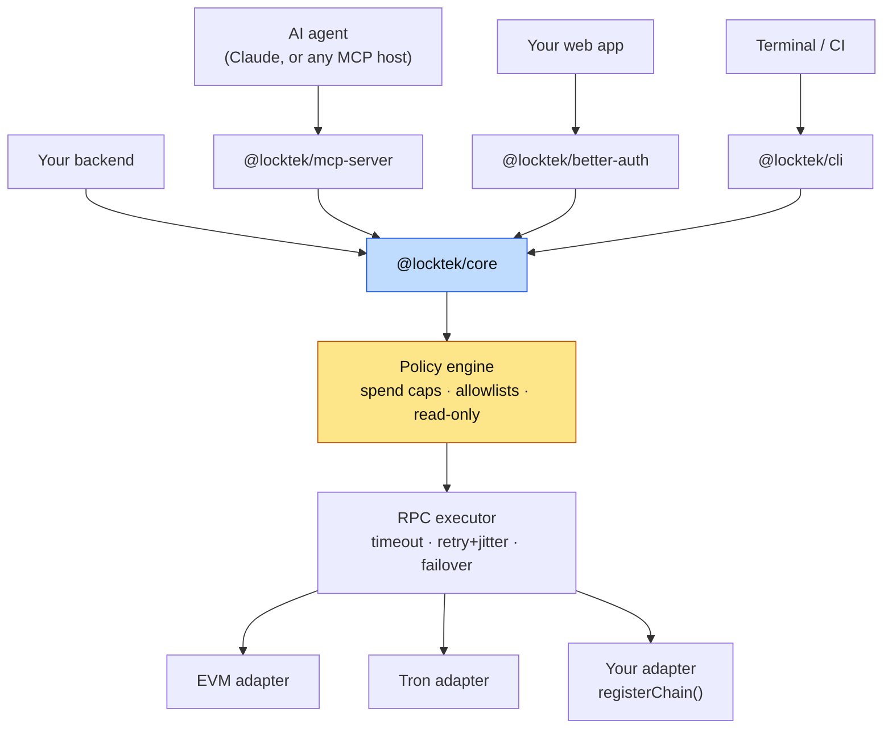

<div align="center">

# Locktek Plug

**Wallet infrastructure for AI agents — where the safety rails are code, not prompts.**

[](https://github.com/locktek-xyz/locktek-plug/actions/workflows/ci.yml)
[](https://github.com/locktek-xyz/locktek-plug/actions/workflows/codeql.yml)
[](./LICENSE)
[](./package.json)
[](#status)

</div>

> [!WARNING]
> **Experimental. Testnet only.** Locktek Plug is pre-1.0, has not been independently
> audited, and has known gaps listed under [Known limitations](#known-limitations). Do not
> put real funds behind it. Testnet mode is on by default; leave it on.

---

## The bug this library exists to prevent

Give a language model a wallet SDK and ask it to send 1 ETH. Most integrations do this:

```ts
BigInt(params.amount); // amount = "1"
```

That sends **1 wei** — a quintillionth of what was asked — and reports success. Ask it to
send `"0.1"` instead and `BigInt` throws a `SyntaxError` in the middle of a payment flow.

Locktek makes the unit contract explicit at every boundary: amounts are always **whole
units**.

```ts
parseNativeAmount('1', 18); // 1000000000000000000n
parseNativeAmount('0.1', 18); // 100000000000000000n
parseNativeAmount('1000000000000000000', 18);
// LocktekError [INVALID_AMOUNT]: Ambiguous amount "1000000000000000000": amounts are
// expressed in whole units, not base units. If you meant 1, pass "1" instead.
```

The ambiguity check only fires for 18-decimal assets, where a base-unit value is an
implausible whole-unit amount. For a 6-decimal token such as USDC, `"1000000"` is read as
one million tokens — so pass whole units, always.

---

## Packages

None of the packages are on npm yet; see [Status](#status).

| Package                                              | What it is                                                                             |
| ---------------------------------------------------- | -------------------------------------------------------------------------------------- |
| **[`@locktek/core`](./packages/core)**               | The SDK: HD wallets, encryption, chain adapters, policy engine, reliability primitives |
| **[`@locktek/mcp-server`](./packages/mcp-server)**   | 12 MCP tools so Claude and other agents can operate a wallet under server-side limits  |
| **[`@locktek/better-auth`](./packages/better-auth)** | BetterAuth plugin: a wallet for each user at signup                                    |
| **[`@locktek/cli`](./packages/cli)**                 | Terminal and scripting interface, with `--json` output                                 |



The MCP server, the CLI, and the `Locktek` facade all build transfers through the same
policy engine and RPC executor. That covers the transfers they build — not everything a
caller can do with the SDK. The ways around it are listed under
[Known limitations](#known-limitations).

---

## Quickstart

Until the first release, build from source:

```bash
git clone https://github.com/locktek-xyz/locktek-plug.git
cd locktek-plug && pnpm install && pnpm build
```

```ts
import { createLocktek } from '@locktek/core';

const locktek = createLocktek({
  chains: ['ethereum-sepolia'],
  encryptionKey: process.env.LOCKTEK_ENCRYPTION_KEY, // 32+ bytes, from a secret manager
});

// Store BOTH ciphertexts. They are the only copy of this wallet.
const wallet = await locktek.createAndEncryptWallet();
console.log(wallet.address, wallet.encryptedPrivateKey, wallet.encryptedMnemonic);

// Amounts are whole units: "0.1" is 0.1 ETH.
const tx = await locktek.buildTransaction({
  from: wallet.address,
  to: '0x0000000000000000000000000000000000000001',
  amount: '0.1',
});

// Decrypt the key only at the moment of signing.
const { privateKey } = await locktek.recoverWallet({
  encryptedPrivateKey: wallet.encryptedPrivateKey,
  chain: wallet.chain,
});

// Reusing the same idempotency key — even after a timeout — resends this exact signed
// transaction. It never signs a second transfer.
const { hash } = await locktek.signAndSend(tx, privateKey!, undefined, {
  idempotencyKey: 'payout-42',
});
```

The default idempotency store lives in memory, so that guarantee holds for the life of
the process. Pass `idempotencyStore` with a durable implementation (Redis, Postgres) to
make it hold across restarts and instances; the CLI ships a file-backed one.

Recovery is verifiable, not hopeful:

```ts
const recovered = await locktek.recoverWallet({
  encryptedPrivateKey: row.encryptedPrivateKey,
  chain: row.chain,
});

recovered.address === row.address; // proves you recovered the right wallet
```

---

## Give an agent a wallet

Add this to `claude_desktop_config.json`, pointing at your local build, with a key for a
**testnet-only** wallet:

```json
{
  "mcpServers": {
    "locktek": {
      "command": "node",
      "args": ["/path/to/locktek-plug/packages/mcp-server/dist/bin.js"],
      "env": {
        "LOCKTEK_CHAINS": "ethereum-sepolia",
        "LOCKTEK_PRIVATE_KEY": "0x… (a testnet wallet you can afford to lose)",
        "LOCKTEK_MAX_AMOUNT_PER_TX": "0.1",
        "LOCKTEK_MAX_AMOUNT_PER_SESSION": "0.5",
        "LOCKTEK_ALLOWED_RECIPIENTS": "0xabc...,0xdef...",
        "LOCKTEK_REQUIRE_CONFIRMATION": "true"
      }
    }
  }
}
```

The signing key is configured on the server and **never crosses the MCP transport**: no
tool takes a private key as input or returns one. Without `LOCKTEK_PRIVATE_KEY` the
server is read-only and does not offer the three signing tools.

### The twelve tools

| Tool                    | Read-only | Notes                                                                                  |
| ----------------------- | :-------: | -------------------------------------------------------------------------------------- |
| `create_wallet`         |           | Returns both ciphertexts; never the raw key                                            |
| `get_balance`           |    ✅     |                                                                                        |
| `get_token_balance`     |    ✅     | ERC-20 / TRC-20                                                                        |
| `estimate_gas`          |    ✅     |                                                                                        |
| `validate_address`      |    ✅     | Checks the EIP-55 checksum on mixed-case input; all-lowercase has none                 |
| `list_chains`           |    ✅     |                                                                                        |
| `health_check`          |    ✅     | Per-endpoint RPC reachability, with API keys stripped from URLs                        |
| `simulate_transaction`  |    ✅     | Issues a single-use token for exactly the simulated transfer                           |
| `wait_for_confirmation` |    ✅     |                                                                                        |
| `send_transaction`      |           | Signing key required; `destructiveHint: true`                                          |
| `confirm_transaction`   |           | Signing key required; redeems a token for the server's own wallet only                 |
| `sign_message`          |           | Signing key required; cannot broadcast, but a signature can authorise things off-chain |

With `LOCKTEK_REQUIRE_CONFIRMATION=true`, every transfer and every signature waits for a
**person** to approve it. The server asks through the MCP client's own UI
([elicitation](https://modelcontextprotocol.io/specification/2025-06-18/client/elicitation)),
showing the resolved amount, base units, recipient, chain, and fee it computed itself.
The model cannot answer that prompt, and a client that cannot show one is refused — the
transfer is not sent.

---

## What the code does, and how it's tested

**Amounts are whole units, everywhere.** Core, CLI, MCP tools, and the BetterAuth plugin
all take `"1"` to mean 1 ETH. For 18-decimal assets, a value that looks like base units
is rejected as ambiguous.

**Testnet by default.** Configuring a mainnet chain throws `MAINNET_BLOCKED` at
construction unless you pass `testnet: false`. EVM transactions are signed with the
configured chain ID (EIP-155), so a mainnet node rejects a testnet transaction. Tron
transactions carry no chain ID, so before building one the adapter checks the endpoint's
genesis block and refuses an endpoint that serves a different network than the chain it
is configured for.

**Every network call has a timeout.** Reads retry with exponential backoff **and jitter**
and fail over across RPC endpoints with per-endpoint cooldown.

**A transfer is signed once.** Writes never retry and never fail over on their own: a
broadcast that timed out may already have landed. With an `idempotencyKey`, the signed
bytes are recorded before the broadcast, so a retry resends that same transaction —
which the network deduplicates — instead of signing a new one. The key is released only
when the node definitively refuses the first broadcast.

**Limits are checked before signing.** Per-transaction caps, per-session caps, recipient
allow/deny lists, and read-only mode are evaluated in the policy engine when the facade
builds a transfer. The session cap reserves synchronously, so two concurrent transfers
cannot jointly exceed it. Caps are plain whole-unit numbers with no asset attached — see
[Known limitations](#known-limitations).

**Wallets are recoverable.** The encrypted BIP-39 mnemonic is stored alongside the
encrypted private key, so a wallet can be restored in any standard wallet application —
including after you stop using Locktek.

**Keys are AES-256-GCM.** 96-bit IV, scrypt KDF, versioned ciphertexts, and multi-key
rotation via `previousKeys`.

**Errors are scrubbed.** Key-shaped hex (64 and 128 characters) is redacted from MCP tool
errors, RPC URLs are reduced to scheme and host wherever an error or health check
reports them, invalid-key errors never echo the key, and `safeLogger` redacts private
keys and mnemonics before they reach a log sink. This is defence in depth over known
paths, not a proof that nothing can leak.

### Tests

| Package                | Tests | Statements |
| ---------------------- | ----: | ---------: |
| `@locktek/core`        |   358 |      91.3% |
| `@locktek/better-auth` |    84 |      98.6% |
| `@locktek/mcp-server`  |    81 |      91.4% |
| `@locktek/cli`         |    66 |      89.4% |

**589 tests, zero network calls.** Coverage thresholds are enforced in CI. The suite is
weighted toward failure paths — timeouts, retries, concurrent access, partial writes —
because that is where money is lost. The README's examples for unit conversion, wallet
creation and recovery, `registerChain`, and testnet mode are mirrored by tests in
[`readme-examples.test.ts`](./packages/core/src/__tests__/readme-examples.test.ts). The
chain adapters run against fakes of the RPC transport; there are no end-to-end tests
against a live or local chain yet.

---

## Known limitations

These are real, and each is a reason the project is testnet-only for now.

- **Caps have no asset.** `maxAmountPerTransaction: '100'` means 100 whole units of
  whatever is being sent: 100 USDC or 100 ETH alike. The session cap is likewise not
  tracked per asset.
- **The policy covers transfers the facade builds, not every path.** Raw `data` calldata
  is not decoded, a caller-supplied `tokenDecimals` is trusted, a transaction can be
  altered between `buildTransaction` and `signAndSend`, the chain adapters are exported
  and can be used directly, and fees are not capped.
- **Nonce gaps do not heal.** If a transaction that consumed a nonce never lands, later
  transactions from that address in the same process queue behind the gap.
- **One shared scrypt salt by default.** The salt is not secret, so it does not contain a
  leaked encryption key. Use a distinct key per tenant or a KMS-backed
  `IEncryptionProvider`.
- **BetterAuth signup with `onWalletCreationError: 'fail'`** fails the signup request, but
  better-auth runs the hook after the user row is committed, so the user exists without a
  wallet. Reconcile on next sign-in.
- **No end-to-end tests against a chain**, and no independent audit.

---

## Supported chains

| Family | Mainnet                                | Testnet                                                    |
| ------ | -------------------------------------- | ---------------------------------------------------------- |
| EVM    | Ethereum, Base, Polygon, Arbitrum, BSC | Sepolia, Base Sepolia, Amoy, Arbitrum Sepolia, BSC Testnet |
| Tron   | Tron                                   | Shasta                                                     |

Mainnet chains are listed because the adapters support them, not because using them is
recommended. Adding a chain does not require a fork:

```ts
import { registerChain, EvmAdapter } from '@locktek/core';

registerChain({
  chain: 'my-l2',
  network: {
    chainId: 12345,
    name: 'My L2',
    symbol: 'ETH',
    decimals: 18,
    chainFamily: 'evm',
    rpcUrls: ['https://rpc.my-l2.example', 'https://rpc2.my-l2.example'],
    explorerUrl: 'https://explorer.my-l2.example',
    isTestnet: false,
  },
  createAdapter: (chain, options) => new EvmAdapter(chain, options),
});
```

---

## Security

Read [SECURITY.md](./SECURITY.md) for the threat model, the custody assumptions, and what
this library does **not** protect you from.

Report vulnerabilities privately through
[GitHub private vulnerability reporting](https://github.com/locktek-xyz/locktek-plug/security/advisories/new).
Never open a public issue for one.

## Status

**Experimental, testnet only, pre-1.0, not independently audited, and not yet published
to npm.** Releases will be published from CI through npm trusted publishing with
provenance, behind a required human approval — see [docs/RELEASING.md](./docs/RELEASING.md).

---

## Development

```bash
pnpm install
pnpm build          # packages consume each other's dist output, so build first
pnpm test
pnpm test:coverage  # thresholds enforced
pnpm lint && pnpm format:check
```

Contributions are welcome — [CONTRIBUTING.md](./CONTRIBUTING.md) explains the review bar,
which is stricter for anything touching signing, key derivation, or fund movement. See
also the [Code of Conduct](./CODE_OF_CONDUCT.md) and the [Changelog](./CHANGELOG.md).

## License

[MIT](./LICENSE) © Locktek
